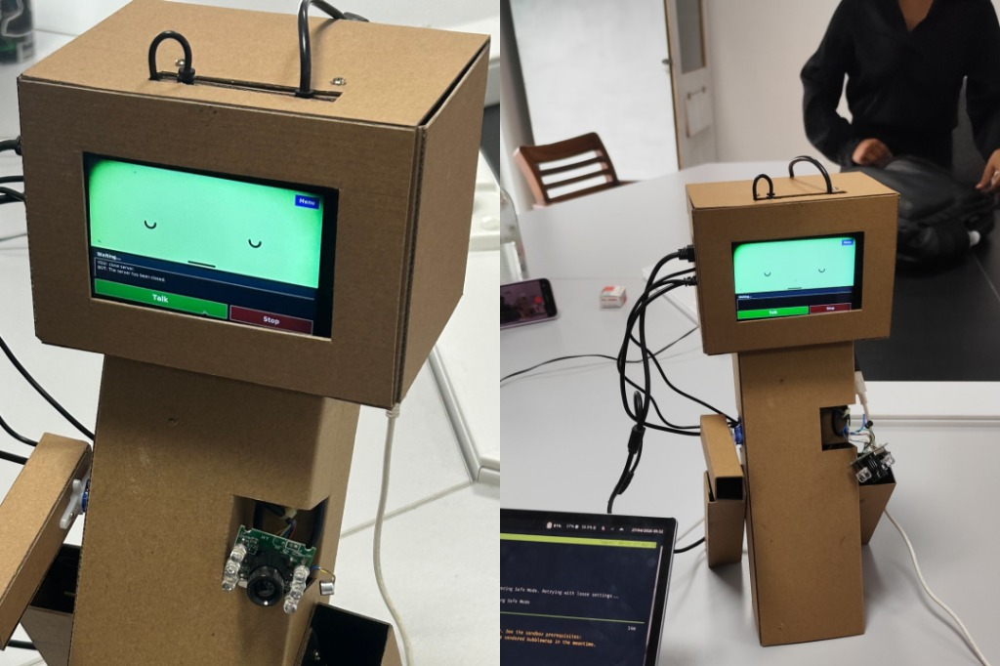

# TARS

  



TARS is a voice agent for Raspberry Pi. It detects a wake word with OpenWakeWord, transcribes speech with `whisper.cpp` or the Groq API, streams chat responses from Groq, and synthesizes speech on the device with Piper TTS. A fullscreen Tkinter window renders PNG sequences from `faces/` and plays WAV effects from `sounds/` as the agent changes state.

## Features

* Runs `llama-3.1-8b-instant` through the Groq API for chat completions and tool calls.
* Detects wake words offline with OpenWakeWord and `.onnx` models.
* Queries microphone sample rates with `sounddevice` and resamples audio to match the active model.
* Transcribes audio with `./whisper.cpp/build/bin/whisper-cli` when present, or sends audio to Groq `whisper-large-v3-turbo`.
* Synthesizes speech with Piper TTS and resamples output to the speaker sample rate.
* Searches news and web results through DuckDuckGo when a prompt requires current information.
* Reads room temperature in Celsius from an ESP32 over USB serial.
* Animates state transitions across `idle`, `listening`, `thinking`, `speaking`, `error`, `capturing`, and `warmup`.

## Hardware requirements

* Raspberry Pi 5 or Raspberry Pi 4 with at least 4 GB RAM
* USB microphone and speaker
* DSI or HDMI display
* Optional ESP32 temperature sensor over USB serial

## Project structure

```text
tars/
├── agent.py
├── setup.sh
├── start_agent.sh
├── tars.desktop
├── tars.jpg
├── wakeword.onnx
├── config.json
├── memory.json
├── requirements.txt
├── whisper.cpp/
├── piper/
├── voices/
├── sounds/
│   ├── greeting_sounds/
│   ├── thinking_sounds/
│   ├── ack_sounds/
│   └── error_sounds/
└── faces/
    ├── capturing/
    ├── error/
    ├── idle/
    ├── listening/
    ├── speaking/
    ├── thinking/
    └── warmup/
```

## Installation

### 1. Prerequisites

Update Raspberry Pi OS and install Git:

```bash
sudo apt update && sudo apt upgrade -y
sudo apt install git -y
```

### 2. Clone and set up

Clone the repository and run the setup script:

```bash
git clone https://github.com/ireallywantthatname/tars.git
cd tars
chmod +x setup.sh
./setup.sh
```

`setup.sh` installs apt packages, downloads the `aarch64` Piper binary and default voice models, creates `venv/`, installs Python packages from `requirements.txt`, and downloads the default `hey_jarvis_v0.1.onnx` model to `wakeword.onnx`.

### 3. Configure Groq

Set your Groq API key in the environment:

```bash
export GROQ_API_KEY="your_api_key_here"
```

### 4. Configure the wake word

To replace the default `hey_jarvis_v0.1.onnx` model with a custom wake word:

1. Train an `.onnx` model with [OpenWakeWord](https://github.com/dscripka/openWakeWord).
2. Copy the file to the repository root as `wakeword.onnx`.

### 5. Run the agent

Start the agent with the launch script:

```bash
./start_agent.sh
```

You can also activate the virtual environment and run `agent.py`:

```bash
source venv/bin/activate
python agent.py
```

Press `Return` to toggle push-to-talk recording, `Space` to interrupt speech playback, or `Escape` to exit fullscreen and save chat history.

## Configuration

Edit `config.json` to change models, audio devices, system prompt text, and serial port settings:

```json
{
  "text_model": "llama-3.1-8b-instant",
  "vision_model": null,
  "transcription_model": "whisper-large-v3-turbo",
  "voice_model": "piper/en_GB-semaine-medium.onnx",
  "chat_memory": true,
  "camera_rotation": 180,
  "system_prompt_extras": "",
  "input_device": null,
  "input_sample_rate": 44100,
  "sensor_serial_port": null,
  "sensor_serial_baud": 115200,
  "sensor_serial_timeout": 2.0
}
```

### ESP32 temperature sensor protocol

When you ask for the room temperature, `agent.py` opens the configured serial port and sends `TEMP\n`. The ESP32 must reply with a newline-terminated string matching `TEMP_C:<number>`, such as `TEMP_C:26.4`.

If `sensor_serial_port` is `null`, `agent.py` selects the first available `/dev/ttyACM*` or `/dev/ttyUSB*` device.

## Customizing character assets

Place PNG files in `faces/<state>/` to change the interface animations. `agent.py` resizes each frame to 800 by 480 pixels and cycles through the sorted filenames.

Place WAV files in `sounds/<category>/` to change sound effects. `agent.py` picks a random WAV file from the matching directory for greetings, acknowledgments, thinking loops, and errors.

## Troubleshooting

* If web search fails, install `duckduckgo-search` in `venv/`.
* If the agent cannot find the temperature sensor, check the USB connection, install `pyserial` in `venv/`, and match `sensor_serial_baud` in `config.json` to the ESP32 firmware.
* If startup exits with a missing key error, export `GROQ_API_KEY` before running `./start_agent.sh` or `python agent.py`.
* If voice playback sounds too fast or too slow, match `PIPER_RATE` in `agent.py` to the `sample_rate` field in your voice model `.onnx.json` file.

## License

MIT License. See [LICENSE](LICENSE) for details.
